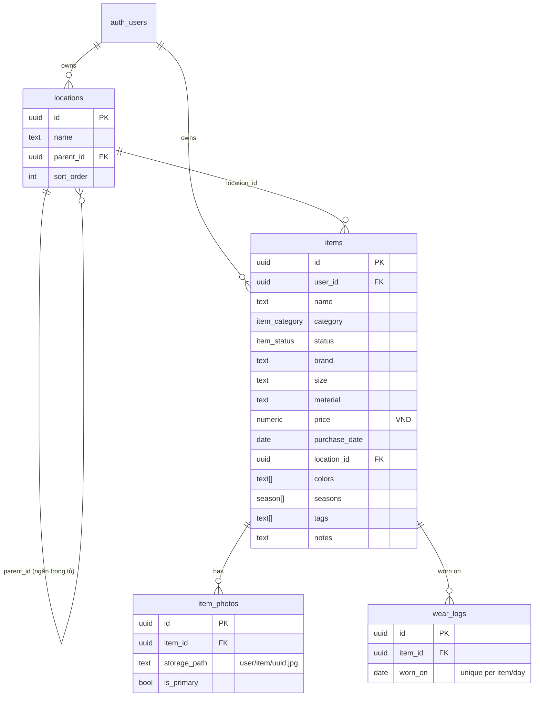

# Data model — Wardrobe app

Backend: Supabase (Postgres + Auth + Storage). Every row belongs to `auth.uid()`; RLS enforces it.

## Decisions

| Topic | Decision | Why |
|---|---|---|
| Colors / seasons / tags | `text[]` / `season[]` columns + GIN index, not join tables | Personal-scale data; simpler queries and CSV import. Move to tables only if tags need rename/merge. |
| Locations | Separate table, with an optional `parent_id` | Filter/rename consistently; supports nested locations like "Tủ phòng ngủ → Ngăn 2". |
| Wear count / last worn | Derived from `wear_logs` via the `items_with_stats` view | No counter drift; enables stats later (cost per wear, wear by month). |
| Photos | Private bucket `wardrobe`, resized client-side to 1200px JPEG, served by signed URLs | Privacy; small files; storage RLS keyed on the first path segment = user id. |
| Price | `numeric(14,0)` VND | No float errors, no decimals needed. |
| Filtering | Client-side over the full list | Hundreds of items load in one query; instant UI. Revisit at more than 2k items. |

## Status / category / season ids
- category: `top, bottom, dress, outer, shoes, bag, accessory, sport, home, other`
- status: `active, stored, laundry, lent, out`
- season: `spring, summer, autumn, winter`
- colors: `den, trang, xam, kem, be, nau, do, hong, cam, vang, xanhla, reu, xanhduong, navy, tim, hoatiet`

## Backlog (v2)
- `outfits`, `outfit_items`; "mặc cả bộ" writes one wear_log per item.
- AI auto-tag: Edge Function `tag-item-photo` that calls a vision LLM server-side (the key never reaches the client).
- Stats page: wears per month, cost per wear = price / wear_count.
