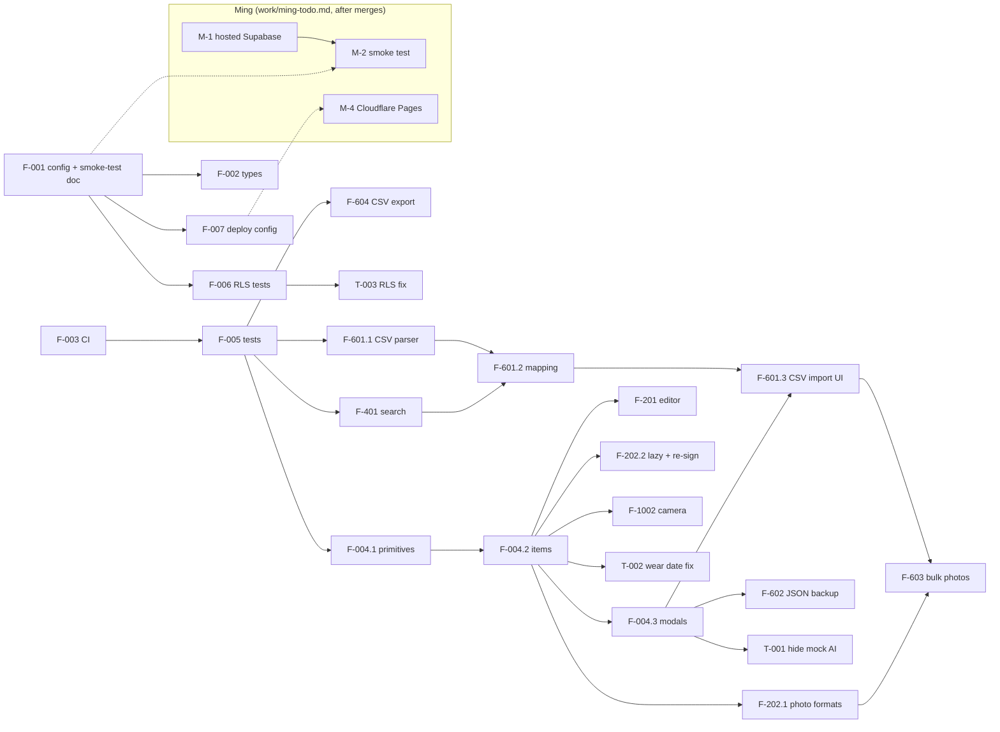

# M1 — Usable MVP: plan

> Backend superseded by D23 (2026-11-10): Supabase was removed in T-016; mentions of Supabase, Auth, RLS and Storage below are historical and are re-planned on the Node backend.

Tickets: `work/tickets/<ID>/ticket.md`, board and run order in `work/backlog.md`, decisions in `work/decisions.md`,
human steps in `work/ming-todo.md`. Source: `docs/feature-list.md`. Written 2026-11-07 against `main` @ `0a6fc32`.
Execution: the `/run` loop described in `CLAUDE.md` → Workflow.

**M1 exit criteria** (feature list §3): a real Supabase project is live; CRUD with photos works; CSV and
photo import are real; there is a deployed URL; CI is green.

## 1. Summary

- **24 tickets**: 21 from the feature list (F-004 → 3, F-601 → 3, F-202 → 2) plus 3 tickets `T-001..003`
  that come from bugs or gaps in the current code (accepted, D9).
- Effort: about **15.5 agent-days** for the feature-list tickets, plus about **1.5** for the T tickets.
- **Critical path ≈ 6 agent-days:** F-003 → F-005 → F-004.1 → F-004.2 → F-004.3 → F-601.3 → F-603.
- With three lanes in parallel (UI split, pure modules, backend), M1 is about **8–10 working days**. Because a
  dependency counts only once it is merged, **how fast Ming merges PRs** sets the pace. The agents never wait
  on Ming's setup steps (D12), only on merges and on the three plan approvals (F-101, F-007, T-003).
- The main constraint is **`App.tsx` (1,547 lines)**. Every ticket that edits it waits for, or is ordered
  around, the F-004 split.

## 2. Dependency graph

## 3. Order and parallel lanes

Lanes can run at the same time. Within a lane, tickets run top to bottom. **Hotspot** = edits `App.tsx` or
the editor; only one hotspot ticket per area should be open at a time.

### Wave 0 — start now (day 1)

| Lane | Tickets | Notes |
|---|---|---|
| Ming | M-1 (hosted Supabase) whenever convenient; merge PRs | Decisions are taken (§5) |
| A — UI | **F-003** (S) → **F-005** (M) | F-005 extracts filter/sort/stale helpers from `App.tsx`, so it must merge before F-004.1 |
| C — backend | **F-001**: `supabase init`, local migration check, `docs/qa/smoke-test.md` (S) | Needs no hosted Supabase |
| — | **F-101** PLAN | High tier (auth): the loop stops after the plan for Ming's approval, early enough to stay off the critical path |

### Wave 1 — after F-005

| Lane | Tickets | Notes |
|---|---|---|
| A — UI (hotspot, serial) | **F-004.1** (S) → **F-004.2** (M) → **F-004.3** (M) | Nothing else edits `App.tsx` meanwhile |
| B — pure modules | **F-401** (S), **F-601.1** (S), **F-604** (S), then **F-601.2** (M) | Live in `src/lib/` and `src/features/*/csv/`. F-604's one-line wiring into `download` must be rebased onto F-004.3 |
| C — backend (after F-001 merges) | **F-002** (S), **F-006** (M), **F-007** (S) | F-007 is High (prod deploy config): plan approval |
| — | **F-101** code (after PLAN approval) | Only touches `AuthGate` and `main.tsx`, so it does not conflict |

### Wave 2 — after F-004.2

| Lane | Tickets | Notes |
|---|---|---|
| A — editor (hotspot) | **F-201** (M) ∥ **F-202.2** (S) | Different files: F-201 = form/footer/Modal, F-202.2 = ItemCard + repo |
| A' — photo input (hotspot) | **F-202.1** (M) → **F-1002** (S) | Both change the editor photo input, so they run in order |
| B | **T-002** (S) | Touches `filters.ts`, the local repo and one editor line |
| C | **T-003** (S), only if F-006 confirms the gaps | High, so Ming reviews |

### Wave 3 — after F-004.3

| Lane | Tickets | Notes |
|---|---|---|
| A | **F-601.3** (M) → **F-603** (M) | F-603 reuses the `importMany` rework from F-601.3 and `preparePhoto` from F-202.1 |
| B | **F-602** (M, after D1), **T-001** (S) | F-602 also changes the export modal; merge before F-603 to avoid conflicts in the import modal |

### Done when
All tickets are merged; Ming has run `docs/qa/smoke-test.md` on the production URL from a phone; CI is green
on `main`. That covers every M1 exit criterion.

## 4. Mismatches between the feature list and the code

Checked by reading the code and running `tsc --noEmit`, `oxfmt --check` and `pnpm build` on 2026-11-07.
"Ticket" is where each one is handled.

| # | Feature | Feature list says / assumes | Code actually | Handling |
|---|---|---|---|---|
| 1 | F-003 | `tsc`, `oxfmt --check` and build run in CI | `tsc` passes and build passes. `oxfmt --check` **fails on all 25 files** on Windows because of CRLF checkout (`core.autocrlf=true`); no oxfmt config. No `typecheck`/`test` scripts. Local pnpm is 11.5.0, but 10.34.3 is pinned | F-003 adds `eol=lf` + scripts + pin |
| 2 | Project `CLAUDE.md` | "Build (also the type/compile check)" | `vite build` does **not** typecheck | Fix the line in F-003 |
| 3 | F-004 | Target folders: components, items, import-export, constants | Also needed to get `App.tsx` < 250 lines: `Header`, `Hero`, the ~230-line demo data, toast. The `App` component alone is ~430 lines | Added to F-004.1 / F-004.2 / F-004.3 |
| 4 | F-004 vs F-005 | §6 runs F-005 in wave 1 and F-004 in wave 2 | Both edit `App.tsx` (F-005 extracts helpers) | F-005 merges first; F-004.1 depends on it |
| 5 | F-005 | Coverage ≥ 80% of `src/data/**` | `src/data/**` includes the Supabase repo (needs a fake client) and `photos.ts` (canvas, not in jsdom) | D6 |
| 6 | F-006 | `supabase start` / `supabase test db` | No `supabase/config.toml` (`supabase init` never run) | F-001 commits it |
| 7 | F-006 | Tests prove isolation | Two policy gaps: `locations.parent_id` can point at another user's location; `item_photos.storage_path` is not checked to start with your own user id (path squatting). No data can be read through them | Probes in F-006, fix in T-003 |
| 8 | F-002 | `supabase gen types --linked` | Needs a Supabase login, so it is a human step or a new `SUPABASE_ACCESS_TOKEN` secret | D11: use `--local` instead |
| 9 | F-007 | Preview deploy per PR with env vars | There is only one Supabase project, so previews would write **production data**, and each preview URL needs a redirect URL entry | D5 (default: previews in local mode) |
| 10 | F-101 | Login matches light **and dark** mode | `AuthGate` renders outside `App`; the `dark` class is set by an effect in `App`, so the login screen is never dark | F-101 moves theme init into `main.tsx` |
| 11 | F-201 | Prevent double submits | `App.save` already ignores a second call; the button just has no loading state. A negative price (and 0) is silently saved as `null` by `itemToRow` | F-201 |
| 12 | F-202 | HEIC accepted / rejected; 10 MB limit | Every upload is re-encoded to JPEG, so the bucket MIME list is not the blocker; Chrome/Firefox cannot decode HEIC. The 10 MB bucket limit applies to the resized ~300 KB file, so the input limit is a product choice. The editor reads photos as data URLs (memory) | F-202.1, D3, D4 |
| 13 | F-202 | Size M | Formats + HEIC + size + progress + lazy loading + URL refresh is more than a day | Split into F-202.1 / F-202.2 (scope unchanged) |
| 14 | F-1002 | `capture="environment"` *and* keep the gallery | On Android Chrome, `capture` opens the camera only, with no gallery | Two buttons (D2) |
| 15 | F-401 | Search across 7 fields | Search covers name, brand, colors and notes only; placeholder matches that | F-401 |
| 16 | F-601 | Values case/diacritic-insensitive; locations find-or-create | Unknown colors pass straight into the DB (no constraint). `ensureLocation` matches exactly, so case variants create duplicate locations | F-601.2, D8 |
| 17 | F-601 / F-603 | Dependency list: none between them | Both need `importMany` reworked: today it stops at the first error and shows nothing until the end. F-601.2 needs F-401's normaliser. F-603 needs F-202.1's photo prep | New deps in F-601.2 / F-601.3 / F-603 |
| 18 | F-602 | Restore into an empty account gives identical JSON; upsert by id | `items.id` is a global PK: restoring into a **second** account while the first exists fails under RLS. Photo paths are owner-scoped and cannot be re-linked. Local mode has no wear logs (counters only) and non-UUID demo ids | D1 |
| 19 | F-602 / F-604 | Export is a mock / "real export" | The CSV BOM is already present (only quoting and fields are missing). The JSON export dumps UI items with expiring signed URLs, and full data: URLs in local mode, while the modal says photos are not included | F-602, F-604 |
| 20 | F-604 → F-601 | CSV re-imports through F-601 | `wear_count` / `last_worn` cannot be imported (derived from wear logs). Re-importing an export creates duplicates (no id column) | D7 |
| 21 | F-603 | AI is M3 (F-703) | The mock's AI checkbox is checked by default; the editor's "Tự điền từ ảnh" is a hard-coded fake that **overwrites** category/colors/seasons/tags | T-001 |
| 22 | Glossary "stale" / daily use | Correct wear dates | `last_worn` is a date-only string parsed as UTC: between 00:00 and 07:00 (UTC+7), "worn today" shows **"-1 ngày"**, and the 90-day boundary shifts. Local mode counts every click; Supabase silently ignores a second wear the same day but still shows the success toast. Duplicate keeps `lastWorn` | T-002 |
| 23 | E10 | F-1002 is the only E10 item in M1 | Matches; noted only because the rest of E10 is M2 | — |

## 5. Decisions (taken 2026-11-07)

Ming delegated these ("tự quyết định"); every default below was taken. The authoritative record, with
D11–D14 added while setting up the workflow, is `work/decisions.md`. No `decision` issues are needed.

| # | Question | Why it matters | Decision |
|---|---|---|---|
| D1 | F-602: how should restore behave when ids already exist in another account? | The AC "restore into an empty account" fails under RLS if the source account still exists | Keep ids when restoring into the same account; if an id belongs to someone else, generate new ids and remap the references. Photos are not restored across accounts. Rewrite the AC as "same account after wipe → identical JSON" |
| D2 | F-1002: two buttons (camera / gallery) instead of `capture` on one input? | `capture` removes the gallery on Android | Two buttons on mobile, a single zone on desktop |
| D3 | F-202: keep the 10 MB input limit? | The file is resized to ~300 KB anyway; some 48 MP photos are > 10 MB | Keep 10 MB as written; it is easy to raise later |
| D4 | F-202: convert HEIC on the client (lazy-loaded library, ~1 MB+) or show an error only? | Bundle size vs desktop HEIC support | Lazy-load the converter only when a HEIC file is picked |
| D5 | F-007: Vercel or Cloudflare Pages? Previews against prod Supabase? | Irreversible-ish setup; previews could write prod data | Cloudflare Pages. Previews run in local mode (no env vars) |
| D6 | F-005: does the 80% coverage target include the Supabase repo and `photos.ts`? | Decides whether a fake Supabase client is needed now | Exclude `photos.ts`; cover the Supabase repo with a small fake client; split into F-005.2 if it grows |
| D7 | F-601: what to do with `wear_count` / `last_worn` columns on import? | They cannot be stored without wear logs | Ignore them and show "ignored columns" in the preview |
| D8 | F-601: match locations case/diacritic-insensitively? | Avoids "Tủ ngăn 1" vs "tủ ngăn 1" duplicates | Yes, match through `normalize()` |
| D9 | Accept T-001 / T-002 / T-003 into M1? In local mode, keep the mock AI controls visible for the Figma Make preview? | Not in the feature list | Accept all three; hide the AI controls in Supabase mode only |
| D10 | Who reviews the first `.github/risk-tiers.yml`? | It sets merge rules for every later PR | Treat it as High: Ming reviews it in F-003 |

## 6. Human steps (Ming)

Tracked as `M-1`…`M-6` in `work/ming-todo.md`. None of them blocks an agent ticket (D12); they are needed for
the M1 exit criteria. Ming's recurring jobs: merge PRs, and approve the plans of F-101, F-007 and T-003 when
`/run` stops on them.

## 7. High-tier tickets (Ming's review, never auto-merged)

- **F-101**: `src/features/auth/**`. PLAN approval, then PR review.
- **F-007**: production deploy config.
- **T-003**: `supabase/migrations/**` (RLS).
- **F-003**: only the first `risk-tiers.yml` (D10); the rest of F-003 is Medium.
